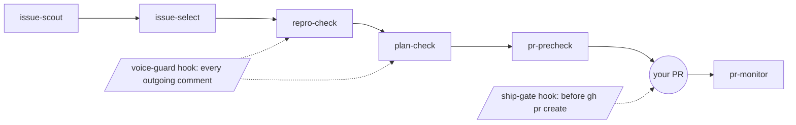

# better-oss

Skills and guardrail hooks for making robust, reliable open source
contributions, as a [Claude Code](https://claude.com/claude-code) plugin.

** Open For Contributions! **


Contributing to a stranger's repo goes wrong in predictable ways: an issue
someone already claimed, a "repro" nobody can rerun, a plan that wanders, a PR
that does more than it says, a comment that sounds like a bot. better-oss holds
each step to a written rubric before it goes out. It **grades and drafts; you
post every word yourself.**



## What is in it

| Piece | What it does |
|---|---|
| `issue-scout` | Searches GitHub with your own queries, ranks results cheaply, grades the best few. |
| `issue-select` | Grades one issue against a rubric: unclaimed? small? the maintainers alive? AI-friendly? |
| `repro-check` | Grades your claim comment and repro report before you post them. |
| `plan-check` | Grades your plan and plan comment against the issue and your repro. |
| `pr-precheck` | Grades your PR title, description and diff against your plan and the repo's own rules. |
| **voice-guard** (hook) | Holds every outgoing `gh` comment and PR body against your voice guide. |
| **ship-gate** (hook) | Before `gh pr create`: runs your repo's checks, then `pr-precheck`; blocks the PR if either fails. |
| **pr-monitor** | Reads your open PR (read-only) and drafts your next move: a review reply, a rebase plan, a nudge, or a wait note. |

## Install

```sh
npx better-oss-cli init
```

That checks your prerequisites, installs the plugin, and copies the example
files you are meant to make your own into `~/.claude/better-oss/`. Without npm,
run this inside Claude Code, then `/better-oss:init`:

```text
/plugin install better-oss --marketplace mobeloper/better-oss
```

You need Claude Code, Python 3.9+, `git`, and `gh` (logged in). The installer
needs Node 18+. See [cli/README.md](cli/README.md) for its options.

**Environment notes.** Nothing needs a virtual environment: the Python code uses
only the standard library. `python3 core/init.py --check` (or `/better-oss:init
--check` in Claude Code) tells you whether `git`, `gh`, `claude` and your `gh`
login are all in place. The skills call the `claude` CLI, so it must be logged in
(or have an API key configured). Your own files live in `~/.claude/better-oss/`;
set `BETTER_OSS_HOME` to use a different folder.

## Five-minute start

1. **Make the voice guide yours.** Open `~/.claude/better-oss/voice-guide.md`
   and rewrite it. The hook enforces it, and until you do it enforces the
   shipped example.
2. **Say what you want.** Edit `fit-profile.md` (languages, repos, size of fix)
   and `search-strategy.md` (the `gh search issues` queries).
3. **Find an issue** in Claude Code (restart it first):

   ```text
   /better-oss:issue-scout
   /better-oss:issue-select https://github.com/OWNER/REPO/issues/123
   ```

4. **Draft, then grade, then post.** Start each draft from
   [`defaults/templates/`](defaults/templates/): `claim-comment.md` and
   `repro-report.md` for `repro-check`, `plan.md` and `plan-comment.md` for
   `plan-check`, `pr-draft.md` and `test-evidence.md` for `pr-precheck`.
5. **Ship.** In your clone, set up `ship-manifest.md` (the checks the project
   asks you to run); `/better-oss:init` prints the exact `cp` commands. Then open
   the PR through Claude Code and the gate runs first. After the PR is open,
   `/better-oss:monitor` drafts your next move.

For a whole run on a real issue, see the [worked example](examples/walkthrough.md).

## Design choices

- **A human posts; the tools grade.** Nothing here comments, claims, or opens a
  PR for you. The monitor's `gh` access is a read-only allowlist in code.
- **The rubrics are the judgment.** Each skill executes a table of checks you
  can read and change (`skills/*/rubric.md`), with evidence cited for every
  grade. The model follows the rubric; it does not improvise one.
- **Guardrails are hooks, so they always run.** Inside Claude Code the voice
  and ship checks fire on every command, not when you remember to ask. They
  fail closed: a crash blocks the command.
- **Your files are separate from the plugin.** Your voice guide, playbook and
  logs live in `~/.claude/better-oss/`, so plugin updates never overwrite them.
- **The model is pinned to Sonnet.** The rubrics were tuned and checked on it,
  so their pass bars only hold there.
- **The repo's rules outrank the tool's.** If a repo forbids AI attribution in PR
  text, `pr-precheck` accepts a description that quotes that rule instead of
  demanding a disclosure.

More in [docs/architecture.md](docs/architecture.md). For the trust boundaries
around the hooks and the ship manifest, see
[docs/threat-model.md](docs/threat-model.md).

## Limits

- Pre-1.0 (`0.0.1`). The rubrics and files may change.
- Built and tested on macOS. The hooks call `python3`, so Windows is untested
  and probably needs work ([see the open issues](https://github.com/mobeloper/better-oss/issues)).
- The scripts, hooks, skills' structure and docs have automated tests, but the
  rubrics' *judgments* do not: a rubric change is judged on manual before/after
  runs.
- Grading calls the model. In the author's runs a candidate costs roughly
  $0.20, so a scan of five is about a dollar; your cost depends on your setup.
- A single maintainer, so replies are best effort.

## Roadmap

v0.1.0 is released. The path to v0.2.0 (enforcing the contribution rules and the
evals in CI, fully testing the hooks, a self-verifying release) and what comes
after it (Windows support, more examples, a standalone CLI) is in
[docs/ROADMAP.md](docs/ROADMAP.md); every item is a
[GitHub issue](https://github.com/mobeloper/better-oss/issues).

## Contributing

Issues, rubric tuning, examples and fixes are WELCOME! 

Start with
[CONTRIBUTING.md](CONTRIBUTING.md); [AGENTS.md](AGENTS.md) is the short guide
for coding agents. Please follow the [Code of Conduct](CODE_OF_CONDUCT.md), and
report security problems through [SECURITY.md](SECURITY.md).

## License

Open Source Under Apache 2.0 [Apache-2.0](LICENSE).

Original Author: Eric Michel.

Copyright. All rights reserved.
